<div align="center">
  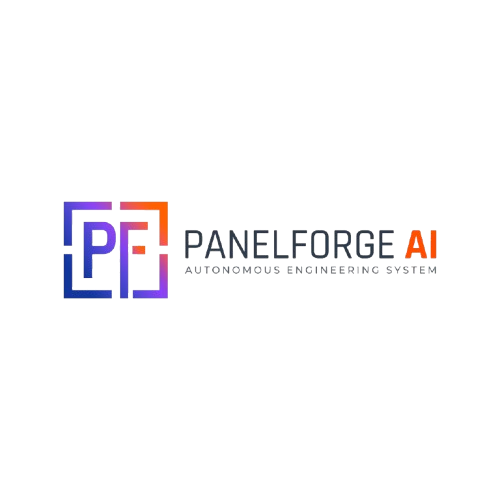
  <h1>PanelForge AI</h1>
  <p><strong>A production-minded engineering skill for admin panels, portals, CRM systems, and SaaS products.</strong></p>
  <p>
    <a href="./GETTING_STARTED.md">Get started</a> ·
    <a href="./SKILL.md">Read the skill</a> ·
    <a href="./reference-app/">Run the reference app</a> ·
    <a href="./MASTER_PROMPT_AUDIT.md">View audit</a>
  </p>
</div>

<p align="center">
  
  
  
  
</p>

## What it is

PanelForge AI is a modular, progressive-loading engineering skill that helps
coding agents build reliable business software without skipping the difficult
parts: requirements, architecture, design systems, RBAC, tenancy, security,
accessibility, testing, operations, and release evidence.

It is designed to be useful in an existing repository, not just for greenfield
mockups. The skill preserves the current stack, loads only relevant guidance,
and reports verified work separately from assumptions or environment blockers.

## Why teams use it

| Productivity outcome | How PanelForge delivers it |
|---|---|
| Faster discovery | Structured project inspection, business workflows, acceptance criteria, and a short task-to-module route |
| Fewer architecture mistakes | Admin, user, CRM, full-stack, database, tenancy, security, and delivery contracts |
| Consistent implementation | Reusable prompts, agent instructions, templates, style records, and engineering standards |
| Fewer regressions | API auth/RBAC/tenant tests, browser/axe tests, operations drills, container health checks, and Lighthouse |
| Executable confidence | A dependency-light reference admin/CRM application with SQLite API and hardened container artifacts |
| Honest delivery | Machine-readable compliance status plus verified, partial, unverified, and blocked states |

## Quick start

```bash
# Clone the skill repository
git clone https://github.com/ihtesham-jahangir/PanelForge-Skill-AI.git
cd PanelForge-Skill-AI

# Run the complete local workflow
python3 scripts/quick_start.py
```

The workflow detects the stack, validates documentation, runs the test suite,
executes backup/restore checks, verifies the reference app health endpoint, and
runs Playwright/axe browser QA when the optional workspace dependencies exist.

For CI integrations:

```bash
python3 scripts/quick_start.py --json
```

For environments without browser dependencies:

```bash
python3 scripts/quick_start.py --skip-browser
```

See [`GETTING_STARTED.md`](./GETTING_STARTED.md) for the shortest route from a
feature request to the right PanelForge modules.

## Install and use the skill

### Option 1: Use it in this repository with GitHub Copilot

The project-local Copilot skill is already included at
[`.github/skills/panelforge-ai/SKILL.md`](./.github/skills/panelforge-ai/SKILL.md).
Open this repository in VS Code with GitHub Copilot enabled, then invoke
**PanelForge AI** from the agent or skill picker. You can also use the
included [PanelForge Engineer agent](./.github/agents/panelforge-engineer.agent.md)
for implementation work.

Example request:

```text
Use PanelForge AI to design and implement a multi-tenant CRM pipeline.
Inspect the existing stack first, preserve its architecture, enforce server-side
RBAC and tenant isolation, and add focused tests and verification evidence.
```

### Option 2: Install into another project

From this repository, run the safe project-local installer:

```bash
python3 scripts/install_skill.py /absolute/path/to/your-project
```

Preview the changes first:

```bash
python3 scripts/install_skill.py /absolute/path/to/your-project --dry-run
```

The installer creates or updates the target project's
`.github/skills/panelforge-ai/` entry without overwriting existing files unless
explicitly allowed by the installer options. Open the target project in VS Code
and invoke **PanelForge AI** from its Copilot skill picker.

### Option 3: Use with another coding agent

Use [`SKILL.md`](./SKILL.md) as the portable orchestrator, then expose the
relevant files through that agent's native project instruction or skill
directory. Do not copy every module into the agent context. Load only the
modules needed for the task:

| Task | Read first |
|---|---|
| Discovery and requirements | [`core/project-discovery.md`](./core/project-discovery.md), [`core/requirements.md`](./core/requirements.md) |
| Admin panel | [`modules/admin.md`](./modules/admin.md), [`modules/security.md`](./modules/security.md) |
| User portal | [`modules/user.md`](./modules/user.md), [`modules/security.md`](./modules/security.md) |
| CRM | [`modules/crm.md`](./modules/crm.md), [`modules/database.md`](./modules/database.md) |
| UI and design system | [`modules/ui-ux.md`](./modules/ui-ux.md), [`design-engine/README.md`](./design-engine/README.md) |
| Full-stack implementation | [`modules/full-stack.md`](./modules/full-stack.md), [`engineering/README.md`](./engineering/README.md) |
| QA and release | [`quality/README.md`](./quality/README.md), [`quality/release-checklist.md`](./quality/release-checklist.md) |

Agent-specific notes are available in the
[compatibility matrix](./adapters/compatibility-matrix.md). External agent
availability is not assumed or reported as verified without runtime evidence.

### Recommended usage workflow

1. **Inspect first:** identify the existing stack, conventions, tests, and current changes.
2. **Define the outcome:** convert the request into workflows, acceptance criteria, ownership rules, and measurable checks.
3. **Load focused guidance:** select only the relevant domain, engineering, security, and QA modules.
4. **Implement completely:** preserve the existing stack and add related tests and documentation.
5. **Verify locally:** run the smallest meaningful checks, then use the quick-start workflow for broader evidence.
6. **Report honestly:** separate passed, partial, unverified, and blocked work.

Every implementation should explicitly consider authorization, tenant ownership,
accessibility, responsive behavior, loading/error/empty states, data integrity,
and rollback impact.

## Reference application

The included [reference app](./reference-app/) demonstrates a responsive,
enterprise-style CRM workspace with:

- Overview, pipeline, people, and audit activity views.
- SQLite-backed API with signed sessions and PBKDF2 password hashing.
- Server-side roles, tenant-scoped queries, audit events, request limits, and security headers.
- Non-root Docker runtime, read-only filesystem support, health checks, backup/restore, and rollback guidance.

Run it locally:

```bash
python3 reference-app/server.py
```

Open <http://127.0.0.1:4173>.

## Design examples

PanelForge supports deliberate visual direction instead of generic dashboards.
These repository-owned examples show how the design engine can guide different
product contexts:

<table>
  <tr>
    <td align="center">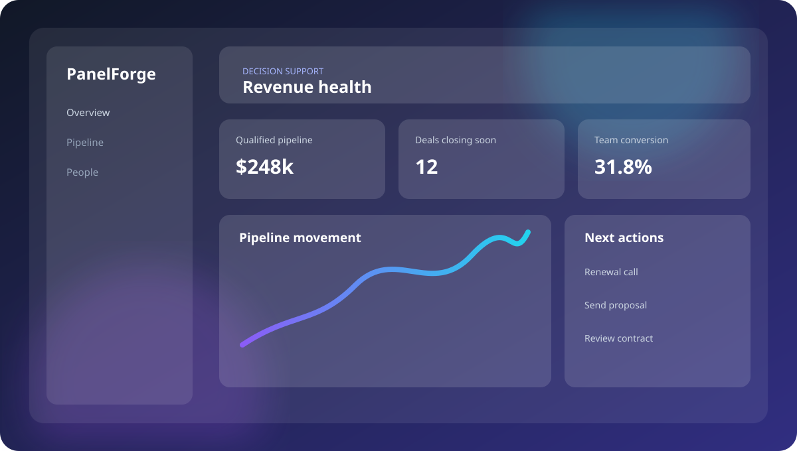<br><strong>Glassmorphism</strong><br><sub>High-signal analytics and premium product surfaces</sub></td>
    <td align="center">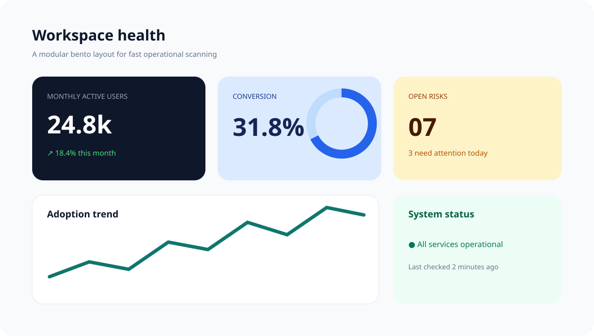<br><strong>Bento SaaS</strong><br><sub>Modular metrics and fast operational scanning</sub></td>
  </tr>
  <tr>
    <td align="center" colspan="2">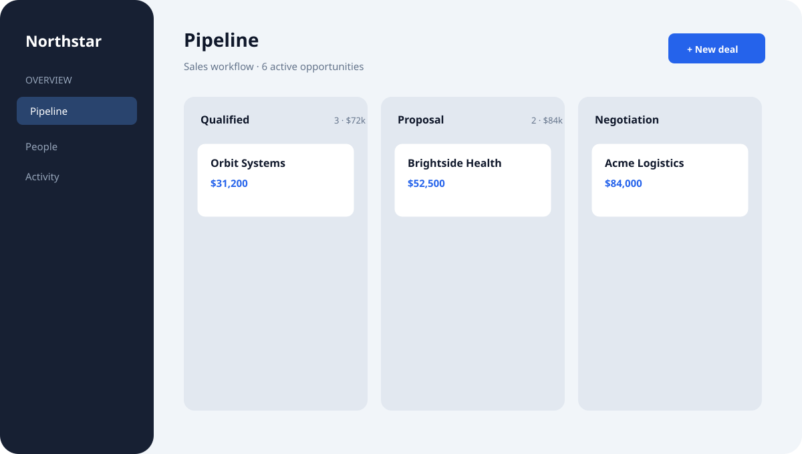<br><strong>Enterprise CRM</strong><br><sub>Dense workflows, pipeline visibility, and role-aware actions</sub></td>
  </tr>
  <tr>
    <td align="center">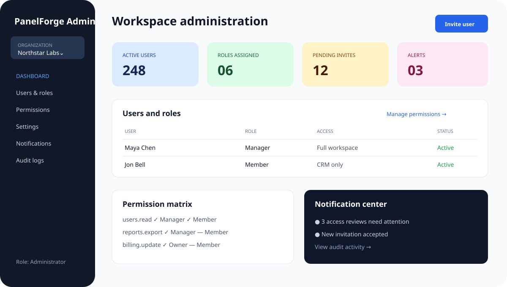<br><strong>Admin control center</strong><br><sub>Organizations, users, roles, permissions, settings, and notifications</sub></td>
    <td align="center">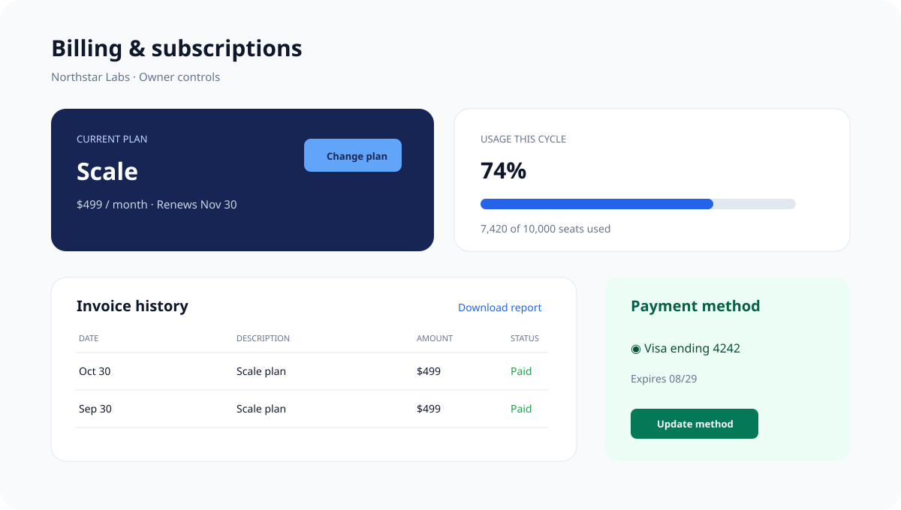<br><strong>Billing &amp; subscriptions</strong><br><sub>Plans, usage, invoices, payment methods, and reports</sub></td>
  </tr>
  <tr>
    <td align="center" colspan="2">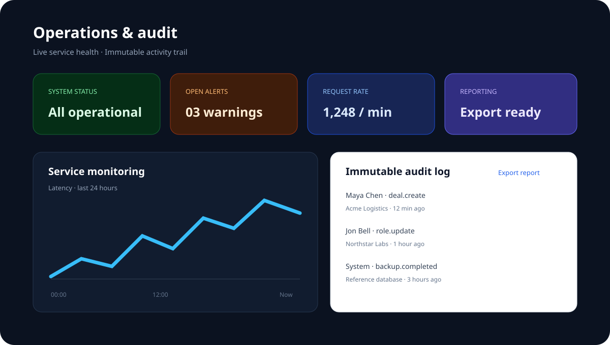<br><strong>Audit &amp; monitoring</strong><br><sub>Service health, alerts, immutable audit events, and operational reporting</sub></td>
  </tr>
</table>

Browse the complete [style catalog](./design-engine/style-catalog.md).

### Complete design style catalog

Every style in the catalog has a repository-owned, dependency-free SVG
reference. These are visual starting points, not production screenshots:

<table>
  <tr>
    <td align="center">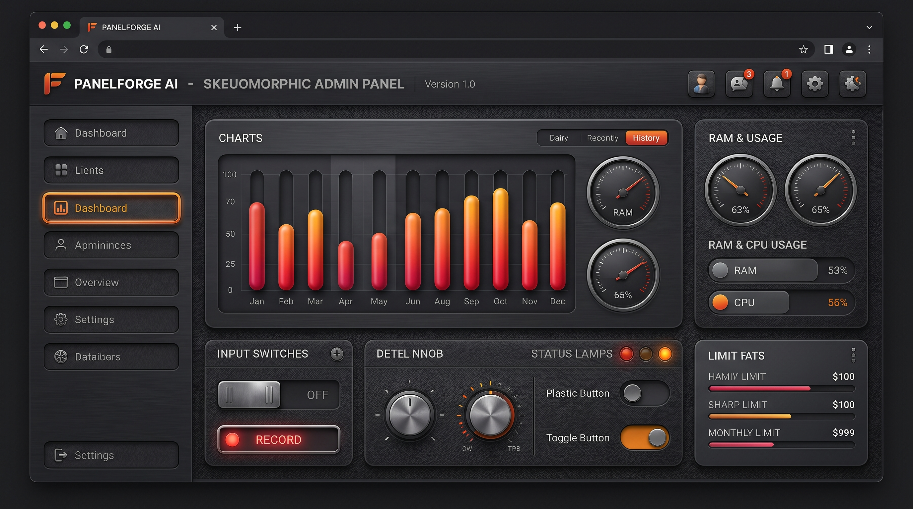<br><strong>Skeuomorphism</strong></td>
    <td align="center">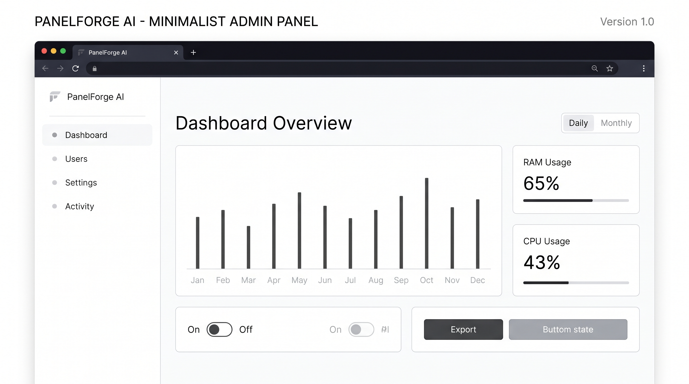<br><strong>Minimalism</strong></td>
  </tr>
  <tr>
    <td align="center">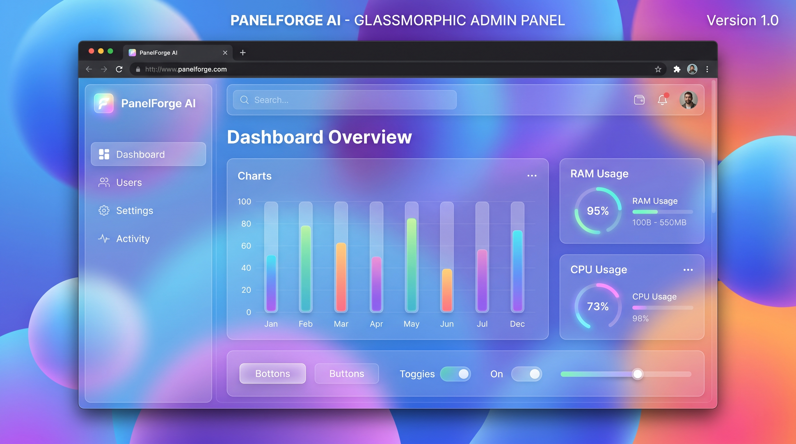<br><strong>Glassmorphism</strong></td>
    <td align="center">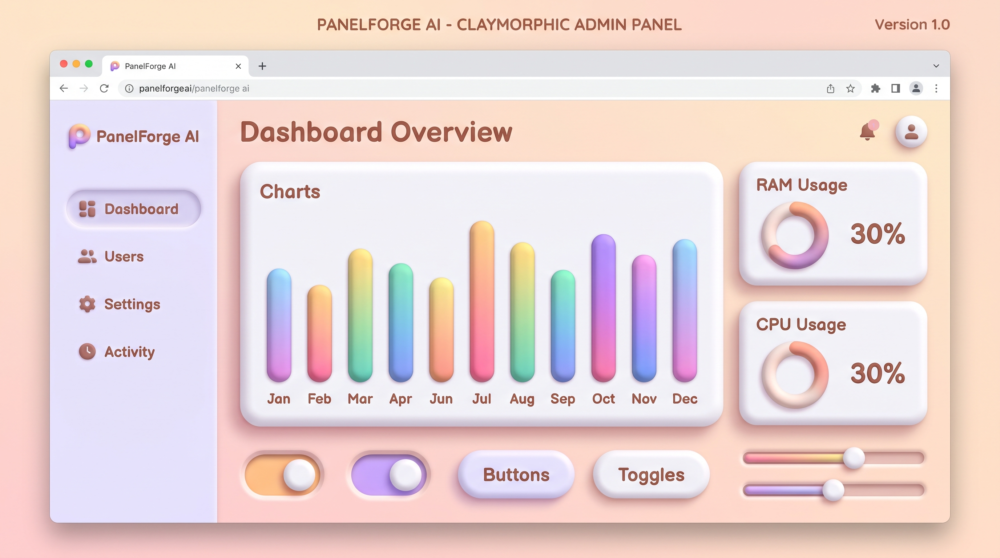<br><strong>Claymorphism</strong></td>
  </tr>
  <tr>
    <td align="center">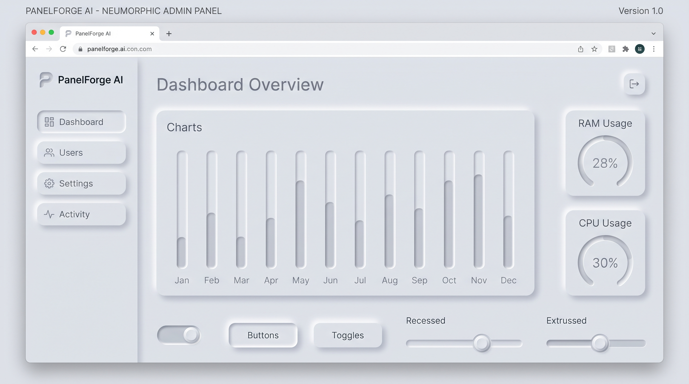<br><strong>Neumorphism</strong></td>
    <td align="center">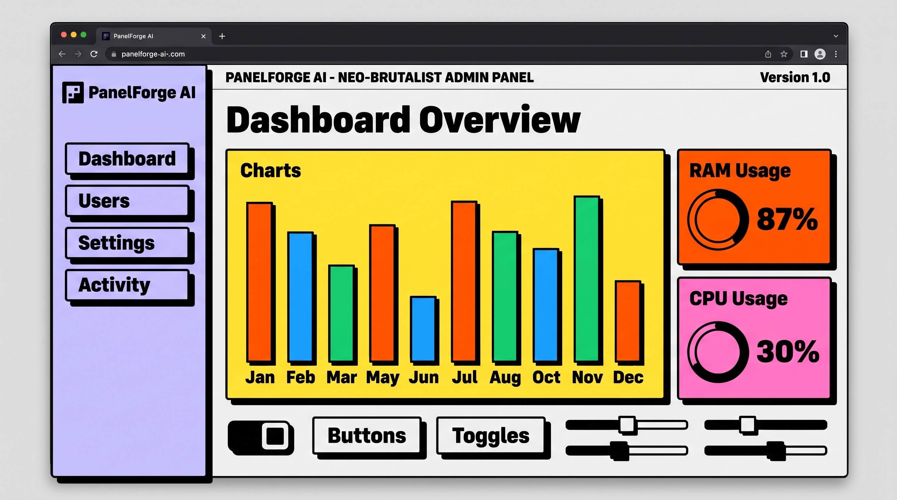<br><strong>Neo-brutalism</strong></td>
  </tr>
  <tr>
    <td align="center"><br><strong>Bento Grid</strong></td>
    <td align="center"><br><strong>Retro Y2K</strong></td>
  </tr>
  <tr>
    <td align="center"><br><strong>Liquid Glass</strong></td>
    <td align="center"><br><strong>Flat Design</strong></td>
  </tr>
  <tr>
    <td align="center"><br><strong>Material Design</strong></td>
    <td align="center" colspan="2"><em>More catalog JPEG references can be added here as they become available.</em></td>
  </tr>
</table>

### Admin component coverage

The visual examples intentionally cover the admin requirements in
[`modules/admin.md`](./modules/admin.md):

| Component family | Visual example |
|---|---|
| Dashboard, analytics, monitoring | [Glassmorphism](./docs/images/glassmorphism-dashboard.svg), [Audit &amp; monitoring](./docs/images/audit-monitoring-dashboard.svg) |
| Users, roles, permissions, organizations | [Admin control center](./docs/images/admin-control-center.svg) |
| Content, settings, notifications | [Admin control center](./docs/images/admin-control-center.svg) |
| Subscriptions, billing, reports | [Billing &amp; subscriptions](./docs/images/billing-subscriptions-dashboard.svg) |
| Audit logs and operational status | [Audit &amp; monitoring](./docs/images/audit-monitoring-dashboard.svg) |

## Repository map

| Directory | Purpose |
|---|---|
| [`core/`](./core/) | Discovery, requirements, architecture, and delivery |
| [`modules/`](./modules/) | UI/UX, admin, user, CRM, full-stack, database, and security |
| [`design-engine/`](./design-engine/) | Style selection, design tokens, and visual direction |
| [`engineering/`](./engineering/) | Implementation contracts and quality boundaries |
| [`workflows/`](./workflows/) | Repeatable discovery, build, QA, and release workflows |
| [`quality/`](./quality/) | Verification, production readiness, and release evidence |
| [`adapters/`](./adapters/) | Copilot, Claude, Codex, Cursor, Windsurf, and generic guidance |
| [`templates/`](./templates/) | Reusable plans, matrices, briefs, and handoff artifacts |
| [`.github/`](./.github/) | Native Copilot skill, prompts, agent, hooks, and CI |
| [`scripts/`](./scripts/) | Installer, validation, quick-start, operations, and specialist wrappers |
| [`qa/browser/`](./qa/browser/) | Optional Playwright, axe-core, and Lighthouse QA |

## Native Copilot integration

This repository includes a project-local skill at
[`.github/skills/panelforge-ai/SKILL.md`](./.github/skills/panelforge-ai/SKILL.md),
a focused [PanelForge Engineer agent](./.github/agents/panelforge-engineer.agent.md),
reusable [prompts](./.github/prompts/), and a non-destructive
[validation hook](./.github/hooks/panelforge-validation.json).

To install the skill into another project:

```bash
python3 scripts/install_skill.py /path/to/target-project
```

## Verification and boundaries

Current local evidence:

- Documentation validation: 88 Markdown files.
- Repository tests: 15 passed.
- Playwright/axe browser QA: 12 desktop/mobile tests passed.
- Lighthouse: performance 100, accessibility 100, best practices 96, SEO 100.
- Container health, non-root runtime, read-only filesystem, and backup/restore verified.

Read the complete [validation report](./VALIDATION_REPORT.md) and
[machine-readable compliance status](./compliance-status.json). External agent
invocation, OWASP ZAP scanning, HTTPS deployment, monitoring, and remote
rollback remain environment-dependent and are not claimed as completed.

## Contributing

Please read [CONTRIBUTING.md](./CONTRIBUTING.md) and [SECURITY.md](./SECURITY.md).
Keep changes focused, add directly related tests, preserve existing patterns,
and include actual verification evidence.

## License

This project is open source under the [MIT License](./LICENSE).
Copyright © 2026 PanelForge-AI Officials.
